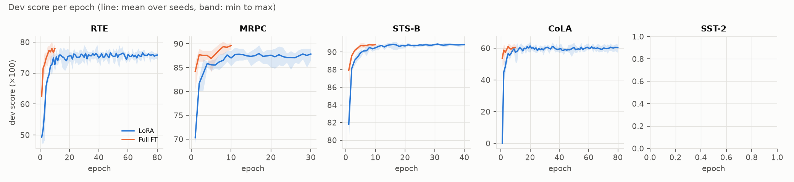
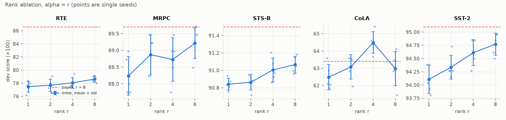
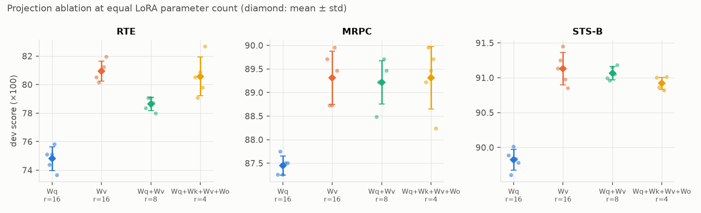
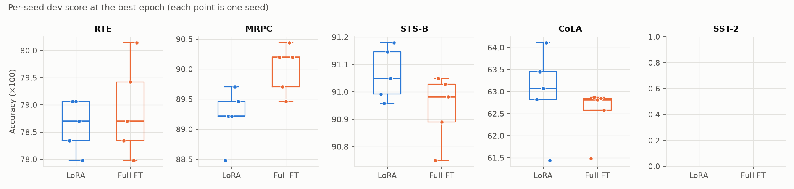

# LoRA on RoBERTa-base (GLUE): a reproduction

A from-scratch PyTorch implementation of Low-Rank Adaptation ([Hu et al., 2021](https://arxiv.org/abs/2106.09685)) and a reproduction of its RoBERTa-base experiments on five GLUE tasks, with a full fine-tuning baseline, a rank ablation and a projection ablation.

[](LICENSE)

## Paper vs. this reproduction

<!-- BEGIN:paper_vs_mine -->
| Task | Metric | Paper (published) | Paper (dagger row) | Mine: mean ± std | Mine: median | Δ (median − paper) | Seeds | Likely reason (hypothesis) |
| :--- | :--- | ---: | ---: | ---: | ---: | ---: | ---: | :--- |
| SST-2 | Accuracy | 95.1 ± 0.2 | n/a | – | – | – | 0 | Not run. |
| MRPC | Accuracy | 89.7 ± 0.7 | n/a | – | – | – | 0 | Not run. |
| CoLA | Matthews corr. | 63.4 ± 1.2 | n/a | – | – | – | 0 | Not run. |
| RTE | Accuracy | 86.6 ± 0.7 | n/a | – | – | – | 0 | Not run. |
| STS-B | Pearson corr. | 91.5 ± 0.2 | n/a | – | – | – | 0 | Not run. |
<!-- END:paper_vs_mine -->

Protocol: scores are GLUE **dev (validation)** results. As in the paper, every run is scored at its best epoch and the paper's statistic is the median over seeds; mean ± std over the same seeds is shown next to it. MRPC, RTE and STS-B start from the pre-trained RoBERTa-base checkpoint, not from an MNLI-adapted one. Table 2 of the paper has dagger rows only for RoBERTa-large, so no dagger value exists for the base model. The "likely reason" column is a text-only hypothesis (`docs/reasons.yaml`), not a verified cause.

## Key findings

<!-- BEGIN:key_findings -->
_No finished runs yet._
<!-- END:key_findings -->

## Quickstart

```bash
make setup          # virtual environment, CUDA build of PyTorch, project and dev dependencies
make test           # lint and unit tests (PEFT parity, merge, zero-init, trainable parameters, resume)
make smoke          # tiny end-to-end LoRA and full fine-tuning runs, a few minutes
make probe          # one-epoch timing probe per task (writes results/probe)
make core           # LoRA and full fine-tuning on all tasks and seeds
make ablation       # rank ablation
make proj_ablation  # projection ablation (run last)
make bench          # latency, memory and size benchmarks (GPU must be idle)
make report         # regenerate every table, figure and the tagged README blocks from results/
```

Training targets go through a queue runner (`scripts/run_queue.py`) that skips finished runs, retries failed ones, records permanent failures in `results/failures.csv`, and resumes an interrupted run from its last finished epoch. Re-running a target continues where it stopped. `make core-detached`, `make ablation-detached` and `make proj_ablation-detached` start the runner as a background process; `python scripts/launch_detached.py --matrix all` runs the three stages in order. The machine must stay awake and the GPU must be free of other work (see [`docs/compute_plan.md`](docs/compute_plan.md)).

Expected runtime on an RTX 4070 SUPER (estimate from the timing probe, next to the measured training time of finished runs):

<!-- BEGIN:runtime -->
| Target | Estimated GPU hours (probe) | Measured train hours | Runs finished |
| :--- | ---: | ---: | ---: |
| `make core` | 15.2 | 0.0 | 0 / 50 |
| `make ablation` (ranks other than the default) | 36.8 | 0.0 | 0 / 75 |
| `make proj_ablation` (variants other than the default) | 4.7 | 0.0 | 0 / 45 |
<!-- END:runtime -->

## Method

LoRA freezes the pre-trained weight `W` and learns a low-rank update for selected matrices:

```
h = W x + (alpha / r) * B A x        W: (out, in) frozen,  A: (r, in),  B: (out, r)
```

`B` is initialised to zero and `A` from a Gaussian, so the adapted model equals the base model at initialisation. The scaling `alpha / r` is kept constant across ranks in the rank ablation (`alpha = r`). By default LoRA is applied to the query and value projections of every attention layer; the target set is configurable (any subset of Wq, Wk, Wv, Wo). The classification head has no pre-trained weights and is always trained; it is not part of the paper's trainable-parameter count.

Implementation notes:

- `src/lora/layer.py`: hand-written `LoRALinear` (frozen base layer, `A`, `B`, optional adapter dropout, `merge()` and `unmerge()`). PEFT is used only in tests.
- `src/lora/inject.py`: wraps the configured attention projections, freezes everything else, counts parameters, exports adapter-only state.
- `src/lora/trainer.py` and `src/train.py`: one training loop for LoRA and full fine-tuning (same data pipeline, optimiser, evaluation), configured by YAML plus command-line overrides; dev metric after every epoch; per-epoch resume; best-epoch adapter export to `adapters/<task>/seed<k>/` (gitignored).
- The Gaussian scale of `A` is not given in the paper; the implementation uses a standard deviation that matches the variance of the usual kaiming-uniform initialisation and does not depend on `r`.

Verification (`make test`):

- Logits of the injected model match Hugging Face PEFT when the same `A` and `B` are copied into a PEFT LoRA model, for the default projections and for all four attention projections; trainable-parameter counts match PEFT.
- At initialisation the LoRA model produces the same logits as the base model.
- `merge()` leaves the outputs unchanged within fp32 tolerance and `unmerge()` restores the original weights.
- Only `A`, `B` and the head require gradients; every other parameter is frozen.
- An interrupted run that is resumed ends with the same per-epoch losses as an uninterrupted run.

## Experimental setup

- Data: GLUE through Hugging Face `datasets` — SST-2, MRPC, CoLA, RTE, STS-B. MNLI, QNLI and QQP are configured but out of scope and never run.
- Metrics: accuracy (SST-2, MRPC, RTE), Matthews correlation (CoLA), Pearson correlation (STS-B, regression with one output). Scores are multiplied by one hundred, as in the paper.
- Selection protocol: best dev epoch per run, median (and mean ± std) over seeds.

<!-- BEGIN:setup -->
- Model: `roberta-base`; LoRA on query and value projections, r = 8, alpha = 8, LoRA dropout 0.0, classification head trained.
- Optimiser: AdamW, linear schedule with 0.06 warm-up ratio, weight decay 0.1, betas (0.9, 0.98), epsilon 1e-06, gradient clipping 1; maximum sequence length 512; bf16 autocast.
- Seeds: none finished.
- Hardware and libraries: –; torch –, transformers –.
- Per-task values below: LoRA from Table 9 of the paper, FT from the fixed point of the RoBERTa fine-tuning grid ([`configs/lora_roberta_base.yaml`](configs/lora_roberta_base.yaml), [`configs/ft_roberta_base.yaml`](configs/ft_roberta_base.yaml)).

| Task | LoRA lr | LoRA batch | LoRA epochs | FT lr | FT batch | FT epochs |
| :--- | ---: | ---: | ---: | ---: | ---: | ---: |
| SST-2 | 0.0005 | 16 | 60 | 2e-05 | 16 | 10 |
| MRPC | 0.0004 | 16 | 30 | 2e-05 | 16 | 10 |
| CoLA | 0.0004 | 32 | 80 | 2e-05 | 16 | 10 |
| RTE | 0.0005 | 32 | 80 | 2e-05 | 16 | 10 |
| STS-B | 0.0004 | 16 | 40 | 2e-05 | 16 | 10 |
<!-- END:setup -->

The full fine-tuning baseline uses one fixed point of the grid in the RoBERTa paper (Liu et al., 2019) for every task, chosen before any run; the paper's published fine-tuning numbers come from Liu et al. and are shown in separate columns.

## Results

### Core: LoRA and full fine-tuning

<!-- BEGIN:core -->
| Task | Method | Trainable params (excl. head) | Best epoch: mean ± std | Best epoch: median | Min – max | Last epoch: mean ± std | Seeds |
| :--- | :--- | ---: | ---: | ---: | ---: | ---: | ---: |
| SST-2 | LoRA (r=8, Wq+Wv) | – | – | – | – | – | 0 |
| SST-2 | Full fine-tuning | – | – | – | – | – | 0 |
| MRPC | LoRA (r=8, Wq+Wv) | – | – | – | – | – | 0 |
| MRPC | Full fine-tuning | – | – | – | – | – | 0 |
| CoLA | LoRA (r=8, Wq+Wv) | – | – | – | – | – | 0 |
| CoLA | Full fine-tuning | – | – | – | – | – | 0 |
| RTE | LoRA (r=8, Wq+Wv) | – | – | – | – | – | 0 |
| RTE | Full fine-tuning | – | – | – | – | – | 0 |
| STS-B | LoRA (r=8, Wq+Wv) | – | – | – | – | – | 0 |
| STS-B | Full fine-tuning | – | – | – | – | – | 0 |
<!-- END:core -->

Effect of the selection rule (LoRA, mean over seeds, best epoch versus last epoch):

<!-- BEGIN:selection -->
| Task | Best-epoch mean | Last-epoch mean | Difference |
| :--- | ---: | ---: | ---: |
| SST-2 | – | – | – |
| MRPC | – | – | – |
| CoLA | – | – | – |
| RTE | – | – | – |
| STS-B | – | – | – |
<!-- END:selection -->

### Full fine-tuning: published numbers and my run

<!-- BEGIN:ft_comparison -->
| Task | Paper FT (Liu et al.) | My FT: mean ± std | My FT: median | Paper LoRA | My LoRA: median | Paper: LoRA − FT | Mine: LoRA − FT (medians) |
| :--- | ---: | ---: | ---: | ---: | ---: | ---: | ---: |
| SST-2 | 94.8 | – | – | 95.1 ± 0.2 | – | +0.3 | – |
| MRPC | 90.2 | – | – | 89.7 ± 0.7 | – | -0.5 | – |
| CoLA | 63.6 | – | – | 63.4 ± 1.2 | – | -0.2 | – |
| RTE | 78.7 | – | – | 86.6 ± 0.7 | – | +7.9 | – |
| STS-B | 91.2 | – | – | 91.5 ± 0.2 | – | +0.3 | – |
<!-- END:ft_comparison -->



### Rank ablation

Mean ± std over seeds (alpha = r):

<!-- BEGIN:rank_mean -->
| Rank | LoRA params (excl. head) | SST-2 | MRPC | CoLA | RTE | STS-B |
| :--- | ---: | ---: | ---: | ---: | ---: | ---: |
| r = 1 | – | – | – | – | – | – |
| r = 2 | – | – | – | – | – | – |
| r = 4 | – | – | – | – | – | – |
| r = 8 | – | – | – | – | – | – |
<!-- END:rank_mean -->

Median over seeds:

<!-- BEGIN:rank_median -->
| Rank | LoRA params (excl. head) | SST-2 | MRPC | CoLA | RTE | STS-B |
| :--- | ---: | ---: | ---: | ---: | ---: | ---: |
| r = 1 | – | – | – | – | – | – |
| r = 2 | – | – | – | – | – | – |
| r = 4 | – | – | – | – | – | – |
| r = 8 | – | – | – | – | – | – |
<!-- END:rank_median -->



### Projection ablation

Which attention matrices receive LoRA, with the trainable LoRA parameter count held at the paper default (rank times number of matrices is constant, alpha = r). The Wq+Wv rows reuse the core runs.

<!-- BEGIN:proj -->
| Adapted matrices | r | LoRA params (excl. head) | RTE: mean ± std | RTE: median | MRPC: mean ± std | MRPC: median | STS-B: mean ± std | STS-B: median |
| :--- | ---: | ---: | ---: | ---: | ---: | ---: | ---: | ---: |
| Wq | 16 | – | – | – | – | – | – | – |
| Wv | 16 | – | – | – | – | – | – | – |
| Wq+Wv (paper default) | 8 | – | – | – | – | – | – | – |
| Wq+Wk+Wv+Wo | 4 | – | – | – | – | – | – | – |
<!-- END:proj -->



### Seed variance

<!-- BEGIN:variance -->
| Task | Seeds | LoRA std | LoRA max − min | FT std | FT max − min | Paper LoRA ± (as printed) |
| :--- | ---: | ---: | ---: | ---: | ---: | ---: |
| RTE | 0 | – | – | – | – | 0.7 |
| MRPC | 0 | – | – | – | – | 0.7 |
| STS-B | 0 | – | – | – | – | 0.2 |
| CoLA | 0 | – | – | – | – | 1.2 |
| SST-2 | 0 | – | – | – | – | 0.2 |
<!-- END:variance -->

<!-- BEGIN:variance_note -->
_Not enough finished runs for the seed-variance comparison._
<!-- END:variance_note -->



## Engineering benchmarks

<!-- BEGIN:bench -->
Measured on NVIDIA GeForce RTX 4070 SUPER (torch 2.11.0+cu128), commit `ea81122`.

**Trainable parameters** (RoBERTa-base with a two-class head; the head is randomly initialised and always trained, and is not part of the paper's count)

| Method | LoRA A/B | Head | Trainable total | Share of full model |
| :--- | ---: | ---: | ---: | ---: |
| Full fine-tuning | – | 124,647,170 | 124,647,170 | 100.0 % |
| LoRA r=1 | 36,864 | 592,130 | 628,994 | 0.50 % |
| LoRA r=2 | 73,728 | 592,130 | 665,858 | 0.53 % |
| LoRA r=4 | 147,456 | 592,130 | 739,586 | 0.59 % |
| LoRA r=8 | 294,912 | 592,130 | 887,042 | 0.71 % |

**Adapter versus full checkpoint (file size)**

| Artifact | Size | Relative |
| :--- | ---: | ---: |
| Full checkpoint (state dict, fp32) | 475.6 MiB | 1× |
| LoRA r=1, A and B only | 0.16 MiB | 3056× smaller |
| LoRA r=1, A, B and head | 2.42 MiB | 197× smaller |
| LoRA r=2, A and B only | 0.30 MiB | 1605× smaller |
| LoRA r=2, A, B and head | 2.56 MiB | 186× smaller |
| LoRA r=4, A and B only | 0.58 MiB | 824× smaller |
| LoRA r=4, A, B and head | 2.84 MiB | 168× smaller |
| LoRA r=8, A and B only | 1.14 MiB | 417× smaller |
| LoRA r=8, A, B and head | 3.40 MiB | 140× smaller |

**Inference latency, merged versus unmerged** (median over many iterations after warm-up, synchronised timing; batch size 1 is launch-bound and noisy)

| Batch | Seq. len. | Precision | Unmerged (ms) | Merged (ms) | Speed-up |
| :--- | ---: | ---: | ---: | ---: | ---: |
| 1 | 128 | bf16 | 12.88 | 8.16 | 1.58× |
| 1 | 128 | fp32 | 7.99 | 6.09 | 1.31× |
| 16 | 128 | bf16 | 10.44 | 8.86 | 1.18× |
| 16 | 128 | fp32 | 22.79 | 21.94 | 1.04× |
| 32 | 128 | bf16 | 17.10 | 15.82 | 1.08× |
| 32 | 128 | fp32 | 45.44 | 43.94 | 1.03× |

Maximum absolute logit difference, merged vs unmerged (fp32): 7.45e-08.

**Peak GPU memory** (bf16 autocast, fp32 parameters, AdamW for training; LoRA inference uses merged weights)

| Mode | Batch | Seq. len. | LoRA (MiB) | Full FT (MiB) | LoRA saving |
| :--- | ---: | ---: | ---: | ---: | ---: |
| train | 16 | 128 | 1271 | 2476 | 49 % |
| inference | 16 | 128 | 541 | 730 | 26 % |
| train | 32 | 128 | 1853 | 3253 | 43 % |
| inference | 32 | 128 | 587 | 771 | 24 % |
<!-- END:bench -->

## Deviations and limitations

All deviations are tabulated in [`docs/deviations.md`](docs/deviations.md). The main ones:

- MRPC, RTE and STS-B start from the pre-trained model. The paper's main LoRA row (and the fine-tuning baseline it quotes) starts these three tasks from an MNLI-adapted model. This is the largest expected source of difference, mostly for RTE.
- Results are on the dev split; GLUE test labels are hidden.
- Several settings are not specified in the paper (weight decay, optimiser betas, gradient clipping, adapter dropout, head training); the chosen values are listed in the deviations file and were fixed before any run.
- Single GPU (RTX 4070 SUPER) and bf16 autocast instead of the original hardware and precision; run-to-run numerical differences are expected.
- My full fine-tuning run uses one fixed setting for every task rather than the per-task sweep behind the published numbers.
- MNLI, QNLI and QQP are not run.

Run coverage (planned versus finished; anything not finished is not reported):

<!-- BEGIN:coverage -->
| Group | Task | Planned | Finished | Not run |
| :--- | ---: | ---: | ---: | ---: |
| Core (LoRA and FT) | RTE | 10 | 0 | 10 |
| Core (LoRA and FT) | MRPC | 10 | 0 | 10 |
| Core (LoRA and FT) | STS-B | 10 | 0 | 10 |
| Core (LoRA and FT) | CoLA | 10 | 0 | 10 |
| Core (LoRA and FT) | SST-2 | 10 | 0 | 10 |
| Rank ablation | RTE | 20 | 0 | 20 |
| Rank ablation | MRPC | 20 | 0 | 20 |
| Rank ablation | STS-B | 20 | 0 | 20 |
| Rank ablation | CoLA | 20 | 0 | 20 |
| Rank ablation | SST-2 | 20 | 0 | 20 |
| Projection ablation | RTE | 20 | 0 | 20 |
| Projection ablation | MRPC | 20 | 0 | 20 |
| Projection ablation | STS-B | 20 | 0 | 20 |

Runs flagged as diverged (non-finite loss): 0. Permanent failures: 0.
<!-- END:coverage -->

## Repository structure

```
configs/     LoRA and full fine-tuning hyperparameters, run matrix
src/lora/    layer, injection, data, metrics, config, trainer, run matrix
src/         train.py (one run), bench.py (benchmarks)
scripts/     queue runner, detached launcher, timing probe, report, paper checks
tests/       unit and integration tests
paper/       numbers transcribed from the paper (paper_results.yaml)
results/     runs.csv, per-run JSON, benchmarks, generated tables
figures/     generated figures
docs/        deviations, compute plan, experiment log, report text mapping
```

## Reproducibility notes

- Every run is seeded (Python, NumPy, PyTorch); the order of training batches depends only on the seed and the epoch. Each run records the configuration hash, git commit, library versions and the GPU in `results/runs.csv` and in `results/runs/<run id>.json`.
- GPU kernels (including bf16 autocast and fused optimiser steps) are not bit-wise deterministic, so repeating a seed can give slightly different scores, which matters most on the small tasks.
- An interrupted run resumes from `checkpoints/` (trainable parameters, optimiser, scheduler, RNG state); the state is deleted when the run completes.
- The paper PDF is not stored; `make paper` downloads it and checks the transcribed numbers against it.

## Citation

Please cite the original paper:

```bibtex
@article{hu2021lora,
  title   = {LoRA: Low-Rank Adaptation of Large Language Models},
  author  = {Hu, Edward J. and Shen, Yelong and Wallis, Phillip and Allen-Zhu, Zeyuan and Li, Yuanzhi and Wang, Shean and Wang, Lu and Chen, Weizhu},
  journal = {arXiv preprint arXiv:2106.09685},
  year    = {2021}
}
```

Other works used: RoBERTa (Liu et al., 2019, arXiv:1907.11692) for the model and the fine-tuning recipe; GLUE (Wang et al., 2019) with SST-2 (Socher et al., 2013), MRPC (Dolan and Brockett, 2005), CoLA (Warstadt et al., 2018), RTE (Dagan et al., 2006; Bar Haim et al., 2006; Giampiccolo et al., 2007; Bentivogli et al., 2009) and STS-B (Cer et al., 2017). Software citation metadata is in [`CITATION.cff`](CITATION.cff).

## License

MIT, see [`LICENSE`](LICENSE).
